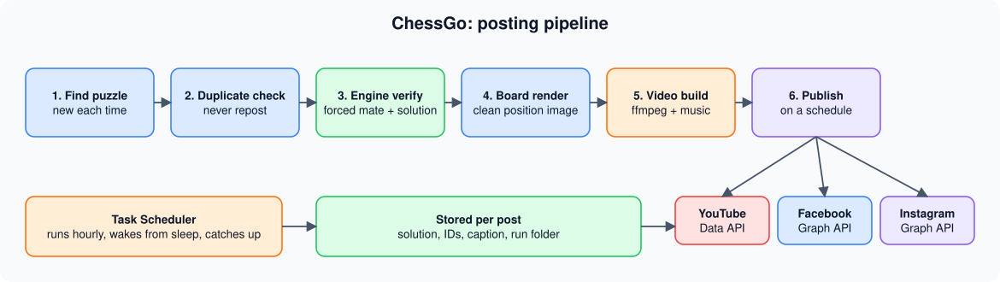
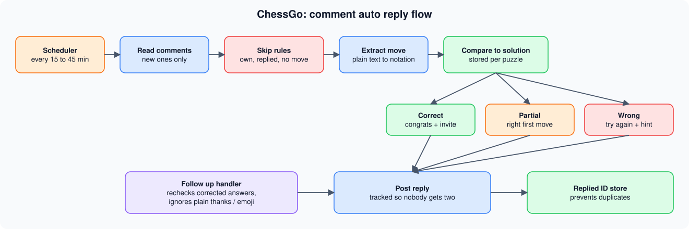

**A fully unattended pipeline that creates chess puzzle videos, posts them on a schedule, and replies to viewers' answers in the comments.**
Built for [Sonic Chess Academy](https://sonic-chess-academy.vercel.app). Runs on one Windows machine with no cloud servers.

---

## At a glance

| | |
|---|---|
| **Platforms** | YouTube, Facebook and Instagram |
| **Puzzle type** | Mate in 2, for both White and Black to move |
| **Checked by** | A local chess engine confirms every puzzle and its solution |
| **Repeat protection** | Never posts the same position twice |
| **Viewer replies** | Reads comments, judges the move, and answers automatically |
| **Runs on** | A single Windows PC using Task Scheduler |

## Pipeline

## Comment auto reply

---

## Explore the details

<b>How a puzzle becomes a video</b>

 

1. **Finds a puzzle** and checks it was never posted before.
2. **Verifies it** with a local chess engine, which confirms a forced mate and records the solution.
3. **Renders the board** as a clean image.
4. **Builds the video** by placing the board on branded vertical (9:16) templates with ffmpeg, with music.
5. **Publishes** to YouTube (Data API) and to Facebook and Instagram (Graph API) on a schedule.

<b>How the comment replies work</b>

 

- Reads new comments and ignores the channel's own, ones already answered, and ones with no move in them
- Pulls the move out of plain text and compares it with the stored solution
- Replies "correct", "right first move" or "not quite", with a follow up for people who push back
- Remembers every reply, so nobody gets answered twice
- Plain thanks and emoji only comments are left alone, to avoid spam

<b>Highlights</b>

 

- Duplicate protection across thousands of past posts
- Handles puzzles for both White and Black to move (board flip, labels, captions)
- Answers verified by an engine, so the comment bot never gives a wrong verdict
- Captions and hashtags generated for each platform
- Self healing scheduling: wakes from sleep, catches up after downtime, retries safely on failures

---

## Engineering stories

<b>The reposting problem</b>

 

Checking the numbers showed the pipeline was reposting puzzles it had already used. A repeat check was added that compares every new position with all past runs, with a large fallback supply of verified puzzles. If nothing fresh is available, it skips the post instead of repeating.

<b>The browser that would not start on a schedule</b>

 

The headless browser worked by hand but failed when launched by Task Scheduler. Rather than chase environment differences, the automation now points at the installed Chrome directly, which made scheduled runs reliable.

<b>Garbled emoji in captions</b>

 

PowerShell 5.1 corrupted emoji written directly in scripts. Emoji are now built from their code points at run time, so captions come out clean.

<b>Instagram needs a public video link</b>

 

Unlike Facebook, Instagram will not take a direct file upload, so the video is first placed somewhere it can be fetched, then handed to Instagram by link.

---

## Tech stack

`Node.js` · `Playwright` · `PowerShell` · `Python` · `ffmpeg` · `Stockfish` · `chess.js` · `YouTube Data API v3` · `Meta Graph API` · `Windows Task Scheduler`
